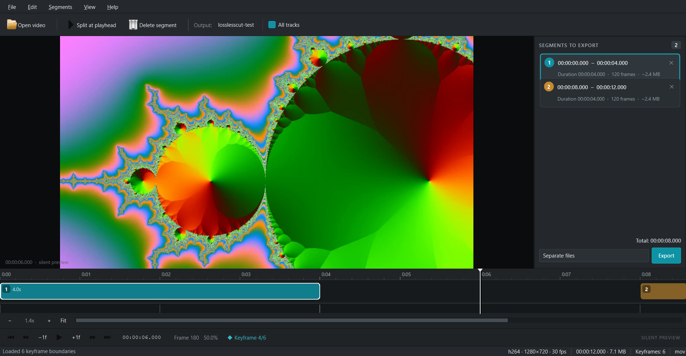

# LosslessCut

A desktop video cutter that removes sections **without re-encoding**. It is inspired by
[LosslessCut](https://github.com/mifi/lossless-cut) and built with Python, PySide6 and
ffmpeg.



## Features

- Open a video with the file dialog or drag and drop it onto the window.
- Keyframe discovery directly from the video packets (with a decoded-frame fallback).
- Zoomable, scrollable timeline showing:
  - adaptive time ruler
  - keyframe boundaries
  - colored segment blocks
  - draggable playhead
- Split segments at the nearest keyframe, delete unwanted parts, and export the rest.
- Export each segment as a separate file, or concatenate the selected segments into one file.
- Lossless output using `ffmpeg -c copy`; the video is never re-encoded.
- Dark Fusion theme with a segment list, duration/frame/size estimates and total duration.
- Silent, frame-accurate preview decoded by ffmpeg. Works with any codec ffmpeg can decode.
- Background metadata/keyframe scanning, real export progress and cancellation.

## Requirements

- Python 3.12+
- [uv](https://docs.astral.sh/uv/)
- `ffmpeg` and `ffprobe` available on `PATH`

On Windows, for example:

```powershell
winget install Gyan.FFmpeg
```

Verify with:

```powershell
ffmpeg -version
ffprobe -version
```

## Setup

```powershell
uv sync
```

Run the application:

```powershell
uv run losslesscut
```

or:

```powershell
uv run python main.py
```

You can also pass a file directly:

```powershell
uv run losslesscut "C:\Videos\movie.mp4"
```

## Usage

1. Open a video or drag it onto the window.
2. Wait for the keyframe scan to finish. The status bar shows the keyframe count.
3. Navigate the timeline and preview:
   - click or drag on the timeline to seek
   - use the mouse wheel to zoom around the cursor
   - Shift+wheel or middle-drag to pan
   - use the frame and keyframe buttons below the timeline
4. Move the playhead inside the full-length segment and press **S** (or **Split at
   playhead**). The split is snapped to the nearest keyframe boundary.
5. Select a segment card and press **Delete** to remove it.
6. Choose an output folder with the **Output** button.
7. Pick **Separate files** or **Merge into one file**, then click **Export**.

Existing files are never overwritten; a numeric suffix is added instead.

## Keyboard shortcuts

| Shortcut | Action |
| --- | --- |
| `Ctrl+O` | Open video |
| `Space` | Play / pause silent preview |
| `Left` / `Right` | Step one frame |
| `Shift+Left` / `Shift+Right` | Jump one second |
| `Up` / `Down` | Previous / next keyframe |
| `Home` / `End` | Go to start / end |
| `S` | Split the active segment at the nearest keyframe |
| `Delete` / `Backspace` | Delete the selected segment |
| `Ctrl+E` | Export segments using the selected mode |
| `Ctrl+Shift+E` | Export all segments merged into one file |
| `+` / `-` | Zoom timeline in / out |
| `F` | Fit the whole video in the timeline |
| `F11` | Toggle full screen |
| `Ctrl+C` | Copy the current timecode |
| `Ctrl+Q` | Quit |

## How the lossless cut works

Every segment boundary is a keyframe timestamp. Export runs ffmpeg with stream copy:

```text
ffmpeg -ss START -i INPUT -t DURATION -map 0 -c copy \
       -avoid_negative_ts make_zero OUTPUT
```

Because the video and audio packets are copied rather than decoded and re-encoded, the
output quality is identical to the source and exports are very fast. A few details follow
from that:

- The cut starts exactly at a keyframe.
- Audio may extend slightly past the requested end because compressed audio frames do not
  align with video frames. This is normal for stream-copy cuts.
- **All tracks** is enabled by default, so audio and subtitle streams are copied too.
  Disable it if the output container cannot hold every stream.
- Merged exports use the source container when it is concat-friendly, otherwise MKV.
  Streams that are incompatible with the chosen container will produce an ffmpeg error.

The preview is deliberately silent and frame-accurate: ffmpeg decodes still frames for
scrubbing and a raw-video stream for playback. No QtMultimedia codecs are involved, so a
file that ffmpeg can read can be previewed even if the operating system cannot play it.

## Project layout

```text
src/losslesscut/
  app.py            application entry point
  theme.py          dark Fusion palette and stylesheet
  models.py         media/segment models, timecode and snapping helpers
  ffmpeg_utils.py   binary discovery and subprocess helpers
  ffprobe.py        metadata and keyframe discovery
  preview.py        ffmpeg frame preview and silent playback
  timeline.py       zoomable custom-painted timeline
  segments.py       segment card list
  exporter.py       lossless cut/merge jobs with progress and cancel
  workers.py        background probe workers
  main_window.py    window, menus, drag and drop, export flow
tests/              unit, ffmpeg integration and Qt smoke tests
```

## Tests

```powershell
uv run pytest
```

The integration tests generate a small H.264/AAC sample with ffmpeg and verify metadata,
keyframe discovery, frame extraction, separate export and merged export. They are skipped
automatically when ffmpeg is not available.

## Known limitations

- Only keyframe-aligned boundaries are offered, by design.
- Preview has no audio.
- The timeline shows one video track; exporting still copies all selected streams.
- Very unusual containers may reject stream-copy output; choose a compatible container or
  disable **All tracks**.
